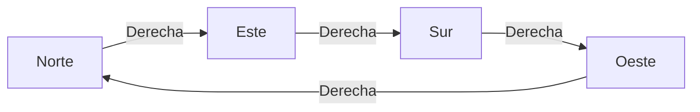
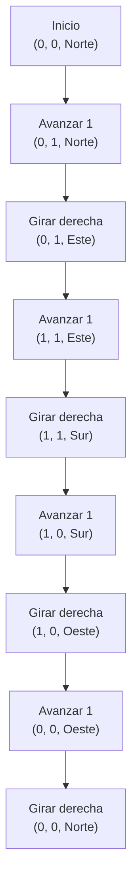
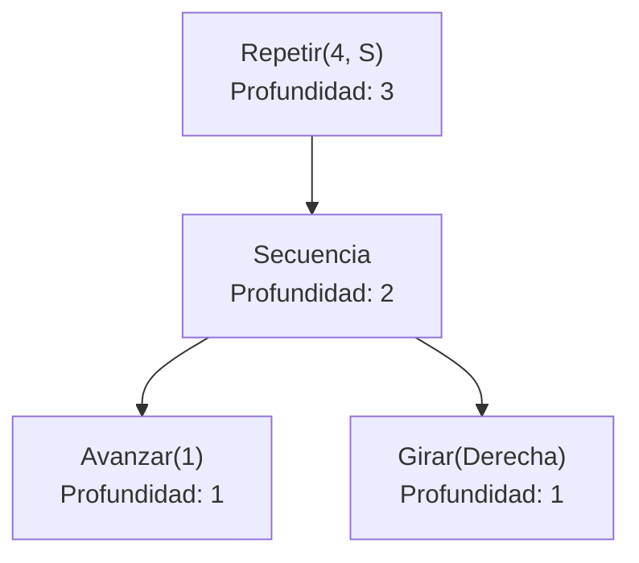
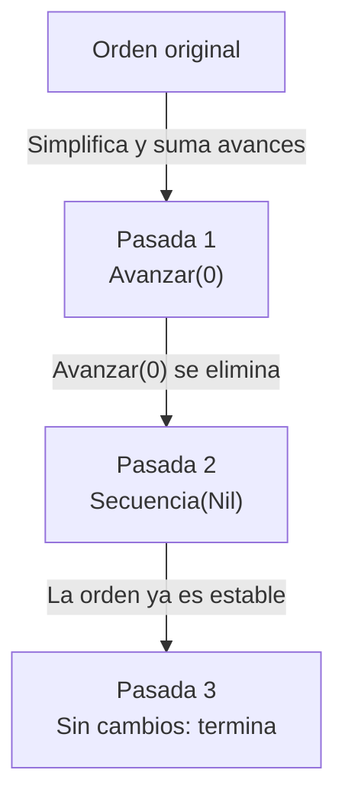

# Informe de proceso: un robot en la cuadrícula

Fundamentos de Programación Funcional y Concurrente — Taller 2.

Convención: el eje $y$ crece hacia el norte y el eje $x$ hacia el este. El estado se representa como $(x, y, \text{mira})$, y el estado inicial es $(0, 0, \text{Norte})$.

## Punto 1: girar

```scala
def girar(d: Direccion, s: Sentido): Direccion = (d, s) match {
  case (Norte, Derecha)   => Este
  case (Este, Derecha)    => Sur
  case (Sur, Derecha)     => Oeste
  case (Oeste, Derecha)   => Norte
  case (Norte, Izquierda) => Oeste
  case (Oeste, Izquierda) => Sur
  case (Sur, Izquierda)   => Este
  case (Este, Izquierda)  => Norte
}
```

Se utiliza `match` sobre la pareja $(d, s)$ y se incluye un caso para cada una de las $4 \times 2 = 8$ combinaciones. Por tanto, no queda ninguna combinación sin cubrir y no hace falta un condicional adicional.

Traza de cuatro giros a la derecha desde el norte:

| Paso | Pareja evaluada | Resultado |
|---|---|---|
| 1 | (Norte, Derecha) | Este |
| 2 | (Este, Derecha) | Sur |
| 3 | (Sur, Derecha) | Oeste |
| 4 | (Oeste, Derecha) | Norte |



## Punto 2: ejecutar

```scala
def ejecutar(e: Estado, o: Orden): Estado = o match {
  case Avanzar(n) =>
    e.mira match {
      case Norte => Estado(e.x, e.y + n, e.mira)
      case Este  => Estado(e.x + n, e.y, e.mira)
      case Sur   => Estado(e.x, e.y - n, e.mira)
      case Oeste => Estado(e.x - n, e.y, e.mira)
    }
  case Girar(sentido) => Estado(e.x, e.y, girar(e.mira, sentido))
  case Repetir(veces, orden) =>
    if (veces <= 0) e
    else ejecutar(ejecutar(e, orden), Repetir(veces - 1, orden))
  case Secuencia(ordenes) =>
    ordenes.foldLeft(e)((estado, orden) => ejecutar(estado, orden))
}
```

Hay un caso para cada alternativa de `Orden`:

- `Avanzar(n)` suma o resta $n$ a la coordenada correspondiente a la dirección. Si $n$ es negativo, el robot retrocede.
- `Girar(sentido)` solo cambia la dirección y delega esa operación en `girar`.
- `Repetir(veces, orden)` ejecuta la orden una vez y vuelve a llamarse con una repetición menos. Si `veces <= 0`, devuelve el estado sin modificarlo.
- `Secuencia(ordenes)` pasa el estado de una orden a la siguiente mediante `foldLeft`. Si la lista está vacía, devuelve el estado recibido.

### Traza del cuadrado

Sea $S = \texttt{Secuencia(List(Avanzar(1), Girar(Derecha)))}$ y la orden
Repetir(4, S) ejecutada desde $(0, 0, \text{Norte})$. En cada fila se ve el estado
y lo que queda por ejecutar.

| Paso | Estado | Orden que queda por ejecutar |
|---|---|---|
| 0 | $(0, 0, \text{Norte})$ | Repetir(4, S) |
| 1 | $(0, 1, \text{Norte})$ | Girar(Derecha), luego Repetir(3, S) |
| 2 | $(0, 1, \text{Este})$ | Repetir(3, S) |
| 3 | $(1, 1, \text{Este})$ | Girar(Derecha), luego Repetir(2, S) |
| 4 | $(1, 1, \text{Sur})$ | Repetir(2, S) |
| 5 | $(1, 0, \text{Sur})$ | Girar(Derecha), luego Repetir(1, S) |
| 6 | $(1, 0, \text{Oeste})$ | Repetir(1, S) |
| 7 | $(0, 0, \text{Oeste})$ | Girar(Derecha), luego Repetir(0, S) |
| 8 | $(0, 0, \text{Norte})$ | Repetir(0, S) |
| fin | $(0, 0, \text{Norte})$ | nada: veces <= 0 devuelve el estado |

El robot recorre un cuadrado de lado 1 y regresa al origen mirando hacia el norte.



### Traza de una secuencia con un avance negativo

Secuencia(List(Avanzar(3), Girar(Izquierda), Avanzar(2))) desde $(0, 0, \text{Norte})$:

| Paso | Orden | Estado resultante |
|---|---|---|
| 0 | — | $(0, 0, \text{Norte})$ |
| 1 | Avanzar(3) | $(0, 3, \text{Norte})$ |
| 2 | Girar(Izquierda) | $(0, 3, \text{Oeste})$ |
| 3 | Avanzar(2) | $(-2, 3, \text{Oeste})$ |

## Punto 3: cuantasBasicas y profundidad

```scala
def cuantasBasicas(o: Orden): Int = o match {
  case Avanzar(_)            => 1
  case Girar(_)              => 1
  case Repetir(veces, orden) => math.max(veces, 0) * cuantasBasicas(orden)
  case Secuencia(ordenes)    => ordenes.map(cuantasBasicas).sum
}

def profundidad(o: Orden): Int = o match {
  case Avanzar(_)         => 1
  case Girar(_)           => 1
  case Repetir(_, orden)  => 1 + profundidad(orden)
  case Secuencia(ordenes) => 1 + ordenes.map(profundidad).foldLeft(0)((a, b) => math.max(a, b))
}
```

Traza de `cuantasBasicas(Repetir(4, S))`:

1. Repetir(4, S) $\to$ $\max(4, 0) \cdot$ cuantasBasicas(S).
2. cuantasBasicas(S) $\to$ cuantasBasicas(Avanzar(1)) $+$ cuantasBasicas(Girar(Derecha)) $= 1 + 1 = 2$.
3. Resultado: $4 \cdot 2 = 8$.

Traza de `profundidad(Repetir(4, S))`:

1. Repetir(4, S) $\to$ $1 +$ profundidad(S).
2. profundidad(S) $\to$ $1 + \max(1, 1) = 2$.
3. Resultado: $1 + 2 = 3$.

La secuencia vacía da $1 + 0 = 1$, porque el máximo de una lista vacía se toma como $0$.



## Punto 4: funciones de alto orden

```scala
def componer(o1: Orden, o2: Orden): Orden = Secuencia(List(o1, o2))

def rutina(pasos: Int)(giro: Sentido)(veces: Int): Orden =
  Repetir(veces, Secuencia(List(Avanzar(pasos), Girar(giro))))

def aplicarA(estados: List[Estado], o: Orden): List[Estado] =
  estados.map(e => ejecutar(e, o))

def transformar(o: Orden, f: Orden => Orden): Orden = o match {
  case Avanzar(_)            => f(o)
  case Girar(_)              => f(o)
  case Repetir(veces, orden) => Repetir(veces, transformar(orden, f))
  case Secuencia(ordenes)    => Secuencia(ordenes.map(x => transformar(x, f)))
}
```

- `componer` construye una `Secuencia` de dos elementos.
- `rutina` está currificada: `rutina(1)(Derecha)` fija los pasos y el giro, y devuelve una función `Int => Orden` que espera el número de repeticiones. `rutina(1)(Derecha)(4)` representa exactamente el cuadrado.
- `aplicarA` usa `map`: aplica `ejecutar` a cada estado y conserva el orden de la lista.
- `transformar` recorre la estructura hasta llegar a las órdenes básicas, les aplica `f` y reconstruye `Repetir` y `Secuencia`, conservando el número de repeticiones y el orden.

Traza de aplicarA(List(inicial, Estado(5, 5, Sur)), Avanzar(2)):

| Estado de entrada | Orden | Estado de salida |
|---|---|---|
| $(0, 0, \text{Norte})$ | Avanzar(2) | $(0, 2, \text{Norte})$ |
| $(5, 5, \text{Sur})$ | Avanzar(2) | $(5, 3, \text{Sur})$ |

Traza de transformar(cuadrado, f) con f que duplica los avances:

1. Repetir(4, S) $\to$ Repetir(4, transformar(S, f)).
2. transformar(S, f) $\to$ Secuencia(List(f(Avanzar(1)), f(Girar(Derecha)))).
3. f(Avanzar(1)) $= $ Avanzar(2) y f(Girar(Derecha)) $= $ Girar(Derecha).
4. Resultado: Repetir(4, Secuencia(List(Avanzar(2), Girar(Derecha)))).

Con esa orden transformada el robot recorre un cuadrado de lado 2 y también vuelve al origen.

Traza de posiciones de rutina(2)(Izquierda)(4), que es Repetir(4, Secuencia(List(Avanzar(2), Girar(Izquierda)))) desde $(0, 0, \text{Norte})$:

| Vuelta | Después de Avanzar(2) | Después de Girar(Izquierda) |
|---|---|---|
| 1 | $(0, 2, \text{Norte})$ | $(0, 2, \text{Oeste})$ |
| 2 | $(-2, 2, \text{Oeste})$ | $(-2, 2, \text{Sur})$ |
| 3 | $(-2, 0, \text{Sur})$ | $(-2, 0, \text{Este})$ |
| 4 | $(0, 0, \text{Este})$ | $(0, 0, \text{Norte})$ |

El robot dibuja un cuadrado de lado 2 hacia la izquierda y vuelve al estado inicial.

Las funciones del punto 3 miden la orden sin ejecutarla, así que el robot no se mueve en ese punto; su traza es la de los cálculos de arriba.

## Punto 5: simplificar

```scala
def simplificar(o: Orden): Orden = {
  def nada(x: Orden): Boolean = x == Secuencia(Nil)

  def juntar(ordenes: List[Orden]): List[Orden] =
    ordenes.foldRight(List.empty[Orden]) { (x, resto) =>
      (x, resto) match {
        case (Avanzar(a), Avanzar(b) :: cola) => Avanzar(a + b) :: cola
        case _                                => x :: resto
      }
    }

  def pasada(x: Orden): Orden = x match {
    case Avanzar(0) => Secuencia(Nil)
    case Avanzar(_) => x
    case Girar(_)   => x
    case Repetir(veces, orden) =>
      val dentro = pasada(orden)
      if (veces <= 0) Secuencia(Nil)
      else if (veces == 1) dentro
      else Repetir(veces, dentro)
    case Secuencia(ordenes) =>
      juntar(ordenes.map(pasada).filterNot(nada)) match {
        case Nil          => Secuencia(Nil)
        case unica :: Nil => unica
        case varias       => Secuencia(varias)
      }
  }

  val siguiente = pasada(o)
  if (siguiente == o) o else simplificar(siguiente)
}
```

`pasada` simplifica la orden una sola vez, de adentro hacia afuera. `simplificar` repite `pasada` hasta que una ejecución ya no modifica la orden, tal como indica el enunciado al decir «tantas veces como haga falta». Las reglas se aplican así:

| Regla | Dónde |
|---|---|
| 1. Avanzar(0) y Repetir(0, _) son Secuencia(Nil) | casos Avanzar(0) y veces <= 0 |
| 2. Dos Avanzar seguidos se juntan | juntar |
| 3. Repetir(1, o) es o | veces == 1 |
| 4. Una secuencia de un elemento es ese elemento | caso unica :: Nil |
| 5. Las órdenes que no hacen nada se quitan | filterNot(nada) |

### Traza de una orden que necesita más de una pasada

Sea

$$o = \texttt{Secuencia(List(Avanzar(1), Repetir(1, Secuencia(List(Avanzar(0), Avanzar(2)))), Avanzar(-3)))}$$

**Primera pasada.** Se simplifican los elementos internos de la secuencia:

1. Avanzar(1) se queda igual.
2. Repetir(1, Secuencia(List(Avanzar(0), Avanzar(2)))): dentro, Avanzar(0) pasa a Secuencia(Nil) y se quita; queda una lista de un elemento, que se vuelve Avanzar(2). Como veces == 1, el Repetir se reemplaza por Avanzar(2).
3. Avanzar(-3) se queda igual.

La lista queda List(Avanzar(1), Avanzar(2), Avanzar(-3)) y juntar la reduce a List(Avanzar(0)), que por tener un solo elemento se vuelve Avanzar(0).

**Segunda pasada.** `Avanzar(0)` se convierte en `Secuencia(Nil)`. Esta regla solo puede aplicarse después de sumar los pasos; por eso no basta con una sola pasada.

**Tercera pasada.** `pasada(Secuencia(Nil))` devuelve `Secuencia(Nil)`, que es igual a la entrada; por tanto, la recursión termina.

| Pasada | Orden resultante |
|---|---|
| 0 (entrada) | Secuencia(List(Avanzar(1), Repetir(1, Secuencia(List(Avanzar(0), Avanzar(2)))), Avanzar(-3))) |
| 1 | Avanzar(0) |
| 2 | Secuencia(Nil) |
| 3 | Secuencia(Nil) (no cambia, se detiene) |



Comprobación con el robot: la orden original desplaza al robot $1 + 2 - 3 = 0$ casillas sin girar. `Secuencia(Nil)` tampoco produce desplazamiento. Desde $(0, 0, \text{Norte})$, ambas órdenes terminan en $(0, 0, \text{Norte})$.